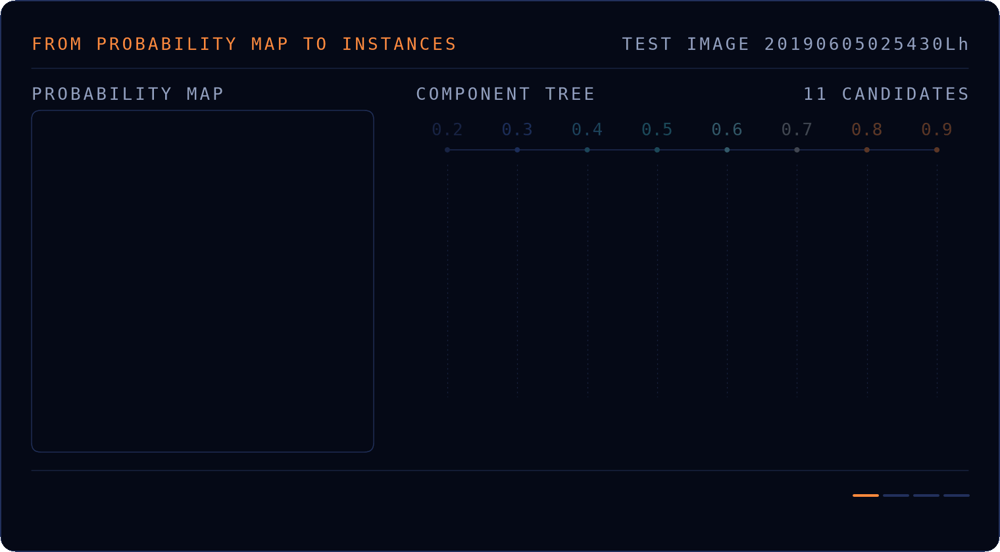
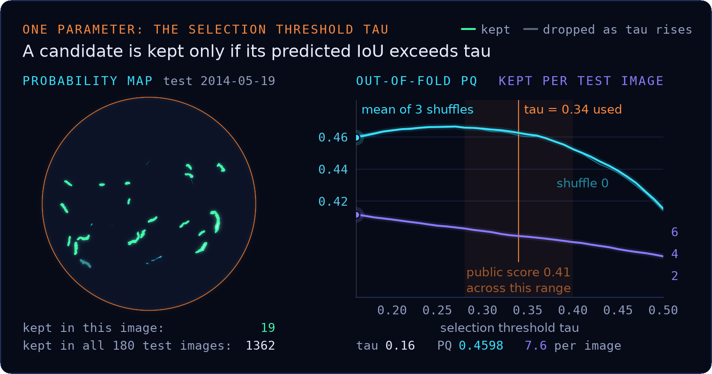

<div align="center">



<p>
<b>Instance segmentation of solar filaments in full-disk H-alpha images.</b><br>
Code of a solution to the <i>Solar Filament Segmentation Challenge 2026</i> (MAGFiLO, GONG H-alpha, 2048 x 2048 images;
metric: pooled multi-annotator Panoptic Quality). Author: Yuvraj Sharma.
</p>

<p>
<a href="#how-it-works">How it works</a> &nbsp;·&nbsp;
<a href="#the-selection-threshold">The threshold</a> &nbsp;·&nbsp;
<a href="#results">Results</a> &nbsp;·&nbsp;
<a href="#quick-start">Quick start</a> &nbsp;·&nbsp;
<a href="#reproducibility">Reproducibility</a> &nbsp;·&nbsp;
<a href="#data-labels-and-licences">Data and licences</a>
</p>

</div>


## At a glance

The reference submission `reference/submission.csv` holds **1010 instances in 180 test images**. One command, or one
notebook, reproduces it exactly from the files of this repository: no GPU, no retraining, no download, about one minute.

```bash
pip install -r requirements.txt
python -m pqtree.pipeline outputs/submission.csv
```

**Method in short.** Pre-trained dense networks give a probability map per image. Thresholding the map at eight levels
and taking connected components gives candidate masks that form a tree. A LightGBM model predicts for every candidate its
expected matched IoU with the annotators, using shape and intensity descriptors, the output of a small CNN that looks at
the candidate, and the agreement of the candidate with instances found by detector networks. A dynamic programme then
selects the set of non-overlapping candidates that maximises the sum of (predicted IoU - tau), with tau = 0.34. The result
is one run-length-encoded mask per kept candidate.

**What is ours and what is not.** The component tree, the hurdle estimate of the matched IoU, the exact dynamic programme
and the use of a single global threshold follow the public notebook of tushhaaarrrr (see [`THIRD_PARTY.md`](THIRD_PARTY.md));
the candidate descriptors, the CNN scorer, the detector-agreement features and this code were written for this project.
The idea of ensemble-disagreement descriptors also appears in that notebook; the implementation here (view-spread and
encoder-gap maps) is ours.


## How it works



The heart of the method is a choice between nested candidates. The animation follows one filament region of a test image
from the probability map to the kept instances; every outline, node and score in it is computed from the stored artefacts.



<table>
<thead>
<tr>
<th width="150" align="left">Stage</th>
<th width="300" align="left">What it does</th>
<th width="226" align="left">Stored output</th>
<th width="162" align="left">Notebook switch</th>
</tr>
</thead>
<tbody>
<tr>
<td valign="top"><b>1 · Dense maps</b><br><sub><code>dense_maps.py</code></sub></td>
<td valign="top">10 U-Nets x 8 dihedral views at 2048 px. Out-of-fold maps for training images, 10-model mean for test images; view-uncertainty and family-gap maps.<br><sub>Input: images, U-Net weights</sub></td>
<td valign="top"><sub><code>{oof,test}_probs_unet.npz</code><br><code>{oof,test}_unc_unet.npz</code><br><code>{oof,test}_fam_unet.npz</code></sub></td>
<td valign="top"><sub><code>RECOMPUTE_MAPS</code></sub></td>
</tr>
<tr>
<td valign="top"><b>2 · Component tree</b><br><sub><code>candidates.py</code></sub></td>
<td valign="top">Components at 8 thresholds, the tree that links them, 33 descriptors, targets from the training annotations.<br><sub>Input: maps, images, annotations</sub></td>
<td valign="top"><sub><code>candidates_{oof,test}.tbl.npz</code><br><code>test_components.npz</code><br><code>ngt_train.json</code></sub></td>
<td valign="top"><sub><code>RECOMPUTE_CANDIDATES</code></sub></td>
</tr>
<tr>
<td valign="top"><b>3 · CNN scorer</b><br><sub><code>cnn_scorer.py</code></sub></td>
<td valign="top">ResNet18 on 4-channel crops, 5-fold cross-fitted, predicts the matched IoU of a candidate.<br><sub>Input: candidates, maps, images</sub></td>
<td valign="top"><sub><code>cnn_scores_{oof,test}.csv.gz</code><br><code>cnn_scorer_f{0-4}.pt</code></sub></td>
<td valign="top"><sub><code>RETRAIN_CNN_SCORER</code><br><code>APPLY_STORED_CNN_WEIGHTS</code></sub></td>
</tr>
<tr>
<td valign="top"><b>4a · Detectors</b><br><sub><code>detector_evidence.py</code></sub></td>
<td valign="top">Instances of 4 detector families x 5 fold models.<br><sub>Input: images, detector weights</sub></td>
<td valign="top"><sub><code>detector_instances_{oof,test}.csv.gz</code></sub></td>
<td valign="top"><sub><code>RECOMPUTE_DETECTIONS</code></sub></td>
</tr>
<tr>
<td valign="top"><b>4b · Evidence</b><br><sub><code>detector_evidence.py</code></sub></td>
<td valign="top">Per candidate: IoU, confidence, coverage and count with respect to the detector instances.<br><sub>Input: instances, candidates</sub></td>
<td valign="top"><sub><code>evidence_{oof,test}.csv.gz</code></sub></td>
<td valign="top"><sub><code>RECOMPUTE_EVIDENCE</code></sub></td>
</tr>
<tr>
<td valign="top"><b>5 · Hurdle LightGBM</b><br><sub><code>lgbm_scorer.py</code></sub></td>
<td valign="top">Hit probability x matched IoU from 52 inputs; cross-fitted scores for the evaluation.<br><sub>Input: all of the above</sub></td>
<td valign="top"><sub><code>lgbm_hit.txt</code>, <code>lgbm_iou.txt</code><br><code>oof_scores.csv.gz</code></sub></td>
<td valign="top"><sub><code>REFIT_LGBM</code></sub></td>
</tr>
<tr>
<td valign="top"><b>6 · Selection</b><br><sub><code>selection.py</code></sub></td>
<td valign="top">Antichain dynamic programme, run-length encoding, validation of the submission.<br><sub>Input: scores, component images</sub></td>
<td valign="top"><sub><code>submission.csv</code></sub></td>
<td valign="top"><sub>none</sub></td>
</tr>
<tr>
<td valign="top"><b>7 · Evaluation</b><br><sub><code>evaluation.py</code><br><code>visualize.py</code></sub></td>
<td valign="top">PQ, IoU and Dice distributions, one-to-many and many-to-one relations on the out-of-fold predictions; pictures.<br><sub>Input: selection, annotations</sub></td>
<td valign="top"><sub>figures and tables of the notebook</sub></td>
<td valign="top"><sub>none</sub></td>
</tr>
</tbody>
</table>

All modules are in `pqtree/`. In file names, `oof` means out-of-fold (training images scored by models that did not see
them) and `unet` the dense maps of the public U-Net ensemble of stage 1. Setting a switch to `True` runs the stage code
and uses its output for the following stages instead of the stored artefact; the notebook refuses inconsistent
combinations. Stage outputs are written to `outputs/`, never over the artefacts. `APPLY_STORED_CNN_WEIGHTS` needs torch
and timm (`requirements-gpu.txt`) and the test images.


## The selection threshold

The method has one free parameter, the threshold tau on the predicted matched IoU. The animation sweeps it over a real
full-disk probability map and over the out-of-fold curve computed from the stored candidate targets. Its counters show
the candidates kept by the selection (1007 at tau = 0.34); the submission has 1010 rows because three images in which
nothing passes the threshold contribute their best candidate as a fallback row.



With pooled PQ = S / (TP + FP/2 + FN/2), every kept instance adds exactly 1/2 per annotator to the denominator, matched or
not. By Dinkelbach's argument for ratio objectives, with exact expected IoUs the optimal threshold equals half the
attainable PQ (about 0.23 here), and the best disjoint set is found exactly by dynamic programming over the tree
(`pqtree.selection.select`): two candidates overlap only if one is an ancestor of the other, so the disjoint sets are the
antichains of the tree.

<details>
<summary><b>Why tau = 0.34</b></summary>
<br>

Our predicted IoUs are optimistic on the kept set and the out-of-fold curve is flat: for shuffle 0 it is highest near
tau = 0.26 (PQ 0.4668) and falls slowly, to 0.4608 at tau = 0.34. We use tau = 0.34, the middle of the range that scored
highest on the public leaderboard (0.41 for every tau from 0.28 to 0.40, 0.40 at 0.24, 0.26 and 0.44; the leaderboard
shows two decimals and scores about half of the test images). If the test images are labelled more sparsely than the
training images, so that each annotated filament is kept with probability r, the expected matched IoU of a candidate
scales by r while the attainable PQ falls by less than that, so the optimal threshold on the predicted IoU rises (by a
factor between 1 and 1 / r). The higher threshold is what the public scores point to, and it costs 0.006 PQ on the
training images for shuffle 0 (0.004 for the mean of the three shuffles, 0.4663 at 0.26 against 0.4625 at 0.34).

</details>


## Results



Out-of-fold results on the 707 training images: every image is scored by models that never saw it; 1154 image-annotator
pairs; pooled PQ. Public leaderboard values are those displayed by the competition site.

<table>
<thead>
<tr>
<th width="470" align="left">Configuration</th>
<th width="180" align="center">Out-of-fold PQ</th>
<th width="180" align="center">Public score</th>
</tr>
</thead>
<tbody>
<tr><td>Dense maps + plain keep rule</td><td align="center">0.4523</td><td align="center">0.39</td></tr>
<tr><td>+ component tree + hurdle LightGBM + CNN scorer</td><td align="center">0.4570</td><td align="center">0.39</td></tr>
<tr><td><b>+ detector evidence (this submission, tau 0.34)</b></td><td align="center"><b>0.4625</b></td><td align="center"><b>0.41</b></td></tr>
<tr><td>Agreement between two annotators (reference)</td><td align="center">0.339</td><td align="center">n/a</td></tr>
</tbody>
</table>

The value 0.4625 is the mean of three cross-fitting shuffles (0.4608, 0.4628, 0.4640); the exact evaluation of shuffle 0
gives 0.4609. The exact evaluation of `notebooks/pipeline.ipynb` (stage 7) gives for shuffle 0: PQ 0.4609, SQ 0.6914,
RQ 0.6666 (TP 4899, FP 1601, FN 3300); the value computed from the stored candidate targets differs by 6e-5. The
out-of-fold PQ as a function of tau (shuffle 0): 0.4645 at 0.20, 0.4658 at 0.24, 0.4668 at 0.26, 0.4646 at 0.30, 0.4608
at 0.34, 0.4569 at 0.38.

**Matched pairs** (IoU > 0.5), n = 4899:

<table>
<thead>
<tr>
<th width="130" align="left">Measure</th>
<th width="115" align="center">Mean</th>
<th width="115" align="center">10 %</th>
<th width="115" align="center">25 %</th>
<th width="115" align="center">50 %</th>
<th width="115" align="center">75 %</th>
<th width="115" align="center">90 %</th>
</tr>
</thead>
<tbody>
<tr><td><b>IoU</b></td><td align="center">0.691</td><td align="center">0.568</td><td align="center">0.630</td><td align="center">0.699</td><td align="center">0.758</td><td align="center">0.799</td></tr>
<tr><td><b>Dice</b></td><td align="center">0.814</td><td align="center">0.725</td><td align="center">0.773</td><td align="center">0.823</td><td align="center">0.862</td><td align="center">0.888</td></tr>
</tbody>
</table>

59.8 % of the annotated masks have a prediction with IoU > 0.5 (best Dice > 0.5: 67.0 %).

**One-to-many and many-to-one relations** (8199 annotated masks, 6499 predictions; two definitions of a partner, see the
notebook). "One-to-many" counts annotated masks with two or more partners, "many-to-one" predictions with two or more
partners.

<table>
<thead>
<tr>
<th width="170" align="left">Partner rule</th>
<th width="165" align="center">One-to-many</th>
<th width="165" align="center">Many-to-one</th>
<th width="165" align="center">Annotated masks without partner</th>
<th width="165" align="center">Predictions without partner</th>
</tr>
</thead>
<tbody>
<tr><td>Overlap (IoU > 0)</td><td align="center">140 (1.7 %)</td><td align="center">137 (2.1 %)</td><td align="center">2320</td><td align="center">612</td></tr>
<tr><td>Half area</td><td align="center">132 (1.6 %)</td><td align="center">123 (1.9 %)</td><td align="center">2686</td><td align="center">1199</td></tr>
</tbody>
</table>


## Quick start

CPU only, from a fresh clone. The repository contains everything the notebook loads by default, including the weights of
our own models and the stored stage outputs (`artifacts/`, about 360 MB, plain git files, no download step). The clone is
large because it carries the five CNN scorer weight files (227 MB) and the stored maps and component images (96 MB).

```bash
pip install -r requirements.txt                  # exact versions, Python 3.11
python -m pqtree.artifacts                        # optional: verify every artefact against artifacts/MANIFEST.json
python -m pqtree.pipeline outputs/submission.csv  # writes the CSV (about 1 minute) and prints its sha256
python -m pytest tests                            # unit tests and the reproduction test
jupyter nbconvert --to notebook --execute notebooks/pipeline.ipynb --output-dir outputs   # the full walk-through
```

The sha256 of the expected CSV is `eab570adfc6309f73db548636041f1dbb8ebb867652dcb90f8fd43ed74b4953a`.

`pqtree.artifacts.fetch_artifact(name)` returns the path of a file in `artifacts/` (or in `$PQTREE_ARTIFACTS`) after
checking its sha256 against the manifest. If a file is missing it raises an error that asks for the complete repository.

Optional inputs of the notebook (environment variables): the competition folder (`PQTREE_COMPETITION_DIR`, with
`train/train_images` and `test/test_images`) and the training annotation file (`PQTREE_TRAIN_JSON`). Without them the
pictures and the exact out-of-fold evaluation of stage 7 are skipped; everything else runs, and the stored outputs of the
notebook show the pictures and the evaluation. The repository contains no competition image files and no annotation file
(see [Data, labels and licences](#data-labels-and-licences)).

### Model weights

<table>
<thead>
<tr>
<th width="180" align="left">Model</th>
<th width="310" align="left">Where</th>
<th width="348" align="left">How the notebook uses it</th>
</tr>
</thead>
<tbody>
<tr>
<td valign="top"><b>LightGBM hit and IoU models</b></td>
<td valign="top"><sub><code>artifacts/lgbm_hit.txt</code><br><code>artifacts/lgbm_iou.txt</code></sub></td>
<td valign="top">Loaded and applied in stage 5 (default path).</td>
</tr>
<tr>
<td valign="top"><b>CNN crop scorer</b><br><sub>5 fold models</sub></td>
<td valign="top"><sub><code>artifacts/cnn_scorer_f0.pt</code> ... <code>f4.pt</code></sub></td>
<td valign="top">Their stored test scores are read by default. <code>APPLY_STORED_CNN_WEIGHTS = True</code> loads the weights and re-scores the test crops (needs torch, timm and the competition images).</td>
</tr>
<tr>
<td valign="top"><b>Dense U-Nets</b><br><sub>third party, CC BY-NC-SA 4.0</sub></td>
<td valign="top">Not redistributed; public Kaggle dataset<br><sub><code>dariushafshar/solar-filament-unet-weights</code></sub></td>
<td valign="top">Their stored maps are read by default. <code>RECOMPUTE_MAPS = True</code> re-runs them from the dataset.</td>
</tr>
<tr>
<td valign="top"><b>Detectors</b><br><sub>third party, AGPL-3.0</sub></td>
<td valign="top">Not redistributed; public Kaggle dataset<br><sub><code>notoverkil/solar-filament-weights</code></sub></td>
<td valign="top">Their stored instances are read by default. <code>RECOMPUTE_DETECTIONS = True</code> re-runs them from the dataset.</td>
</tr>
</tbody>
</table>

The submitted CSV is reproduced from the stored outputs without any file from outside the repository. Both third-party
datasets are described in [`THIRD_PARTY.md`](THIRD_PARTY.md).


## Reproducibility

<table>
<thead>
<tr>
<th width="318" align="left">Path</th>
<th width="200" align="left">Hardware</th>
<th width="320" align="left">Time</th>
</tr>
</thead>
<tbody>
<tr><td valign="top"><code>python -m pqtree.pipeline</code><br><sub>stored artefacts</sub></td><td valign="top">CPU, 4 cores, 0.3 GB peak RAM</td><td valign="top">about 1 min</td></tr>
<tr><td valign="top"><code>notebooks/pipeline.ipynb</code><br><sub>all switches <code>False</code>, without the competition data</sub></td><td valign="top">CPU, 3-4 cores, 0.5 GB peak RAM</td><td valign="top">about 2 min</td></tr>
<tr><td valign="top"><code>notebooks/pipeline.ipynb</code><br><sub>all switches <code>False</code>, with the competition folder and the annotation file</sub></td><td valign="top">CPU, 3-4 cores, 1.6 GB peak RAM</td><td valign="top">about 6 to 8 min (5.5 min measured with 3 cores); the exact evaluation of stage 7 takes most of it</td></tr>
<tr><td valign="top"><code>REFIT_LGBM = True</code></td><td valign="top">CPU</td><td valign="top">about 15 min (final fit 1 min; three cross-fitting shuffles 4.5 min each)</td></tr>
<tr><td valign="top"><code>RECOMPUTE_EVIDENCE = True</code></td><td valign="top">CPU</td><td valign="top">about 55 min</td></tr>
<tr><td valign="top"><code>RECOMPUTE_MAPS = True</code></td><td valign="top">2 x GPU (Tesla T4 class)</td><td valign="top">about 40 min</td></tr>
<tr><td valign="top"><code>RETRAIN_CNN_SCORER = True</code></td><td valign="top">1 GPU (T4)</td><td valign="top">about 25 min</td></tr>
<tr><td valign="top"><code>RECOMPUTE_DETECTIONS = True</code></td><td valign="top">1 GPU (T4)</td><td valign="top">about 1 h</td></tr>
</tbody>
</table>

Run times of the GPU stages are those of the Kaggle runs that produced the stored results. Package versions: see
`requirements.txt` (default path, notebook and tests; versions of the container in which they were run) and
`requirements-gpu.txt` (GPU stages). The LightGBM fit is deterministic here: two fits on identical inputs gave
bit-identical predictions, and the stored models give the reference CSV exactly. Recomputing the GPU stages gives slightly
different results and therefore possibly a slightly different CSV.

<details>
<summary><b>GPU stages and their check</b></summary>
<br>

Stages 1, 3 (training) and 4a were computed on Kaggle T4 GPUs before the code was arranged as this package. Their
results are stored in `artifacts/` because GPU inference is not bit-reproducible. `tools/gpu_stage_check.py` runs the
packaged stages on six images in a Kaggle GPU session and compares them with the stored results (maximum and mean
differences of the maps, instance-level agreement of the detections, difference of the CNN scores; PASS / FAIL per stage
with the tolerances stated in the script). The CPU stages were checked by exact reproduction of the submission.
`run_detectors` loads third-party checkpoints with `torch.load(weights_only=False)`: use only the files of the public
dataset.

The check re-ran the packaged stages on 3 test and 3 training images in a Kaggle GPU session (Tesla T4; Python 3.13,
torch 2.11.0, timm 1.0.30, ultralytics 8.4.121) and compared them with the stored results: dense maps, CNN scorer and
7 of 8 detector rows pass, the test Mask R-CNN row fails. Repeating the check gave the same outcome. The
failing row comes from two instances in image 20130609133454Bh (a confidence of 0.201 against 0.635 in one matched pair,
and one stored instance with best new IoU 0.826). The full record is `tools/gpu_stage_check_result.json`; the tolerances
are stated in the script. The stored detections are the ones the pipeline uses.

<table>
<thead>
<tr>
<th width="250" align="left">Stage</th>
<th width="460" align="left">Measured</th>
<th width="120" align="center">Verdict</th>
</tr>
</thead>
<tbody>
<tr>
<td valign="top"><b>Dense maps</b><br><sub>6 map types, uint8 units</sub></td>
<td valign="top">Max abs difference 1 to 10 grey levels, mean 4e-5 to 2.5e-4.</td>
<td valign="top" align="center">PASS</td>
</tr>
<tr>
<td valign="top"><b>CNN scorer</b><br><sub>stored weights, 164 training and 205 test candidates</sub></td>
<td valign="top">Max abs difference 0.00035 (training images) and 0.00007 (test images); mean 8e-5 and 2e-5.</td>
<td valign="top" align="center">PASS</td>
</tr>
<tr>
<td valign="top"><b>Detectors, 7 of 8 rows</b><br><sub>training images: Mask R-CNN, YOLO11m 1536, YOLO11m 2048, YOLO26m; test images: YOLO11m 1536, YOLO11m 2048, YOLO26m</sub></td>
<td valign="top">100 % of the stored instances with confidence >= 0.2 have a new instance at IoU >= 0.9; confidence differences of these pairs <= 0.0054; instance counts equal, except 37 stored against 38 new (YOLO11m 1536, training images).</td>
<td valign="top" align="center">PASS</td>
</tr>
<tr>
<td valign="top"><b>Detectors, test images</b><br><sub>Mask R-CNN 1536</sub></td>
<td valign="top">162 stored and 162 new instances; 85 of 86 stored instances with confidence >= 0.2 matched (98.8 %); largest confidence difference of a matched pair 0.4339, mean 0.0053.</td>
<td valign="top" align="center"><b>FAIL</b><br><sub>outside the rule</sub></td>
</tr>
</tbody>
</table>

</details>

<details>
<summary><b>Third-party models used by the recompute path</b></summary>
<br>

Stages 1 and 4a read public Kaggle datasets (not copied into this repository, see `THIRD_PARTY.md`):

* `dariushafshar/solar-filament-unet-weights` (CC BY-NC-SA 4.0): ten U-Net fold models; set `PQTREE_UNET_WEIGHTS` to the
  folder containing the checkpoints, `folds.csv` and `solar_unet_receipt.json`.
* `notoverkil/solar-filament-weights` (AGPL-3.0): detector fold models; set `PQTREE_DETECTOR_WEIGHTS` to the dataset folder
  (`manifest.json`, `splits/folds.csv`, one folder per model run).

Download both datasets into `third_party_weights/solar-filament-unet-weights` and `third_party_weights/solar-filament-weights`
(the defaults of the notebook) or point the variables at other folders. Both were trained on the competition training images
only, with published fold assignments. Training images are processed only by the models that did not see them, so the
training-set features used by the LightGBM model are out-of-fold.

</details>

<details>
<summary><b>Statistics of the technical report</b></summary>
<br>

```bash
python tools/report_statistics.py --train-json /path/to/MAGFiLO_1.0_Annotations_kaggle2026_train.json   # or set PQTREE_TRAIN_JSON
```

The script selects the instances for cross-fitting shuffle 0 at `config.TAU` from the stored out-of-fold artefacts, scores
them against every annotator and prints the evaluation statistics quoted in the technical report of this entry (pooled PQ, SQ, RQ and TP / FP / FN with
bootstrap intervals, PQ per group of annotation batches, PQ per annotator-image, IoU and Dice of the matched pairs,
relation degrees, morphology of kept and annotated masks, the three-shuffle mean PQ at tau 0.26, 0.30 and 0.34) and writes
them to `outputs/report_statistics.json`. It needs the artefacts and the training annotation file of the competition (no
image files) and takes about 5 minutes on 3 CPU cores.

</details>

<details>
<summary><b>Figures of this page</b></summary>
<br>

Every figure of this page is drawn from the stored artefacts by a script in `tools/readme_media/` and written to
`docs/media/`:

```bash
python tools/readme_media/build_all.py
```

The scripts need only the files of this repository (about 8 minutes on 3 CPU cores). They use model outputs (probability
maps, component images, candidate tables, the reference submission), for the out-of-fold curve the label-derived
aggregates named under [Data, labels and licences](#data-labels-and-licences), and the evaluation numbers listed in
`tools/readme_media/numbers.json`.

</details>


## Data, labels and licences

Competition data: Ahmadzadeh et al., *A dataset of manually annotated filaments from H-alpha observations*, Scientific Data
11, 1031 (2024), doi:10.1038/s41597-024-03876-y; competition: *Solar Filament Segmentation Challenge 2026*,
https://kaggle.com/competitions/filament-segmentation-2026. This work uses GONG data obtained by the NSO Integrated
Synoptic Program, managed by the National Solar Observatory (AURA, NSF), with contributions from NOAA.

The repository contains no competition image files, no annotation file, and no polygons or masks of the annotators. The
executed notebook shows crops and one complete image of H-alpha test images with our predicted outlines (one crop in three
figures, a gallery of eight crops, one complete image) and one training crop with the annotators' outlines (H-alpha images
from the GONG network, NSO; MAGFiLO annotation outlines; CC BY-NC 4.0, non-commercial use, credit as in the data reference
above). The figures of this page contain no image and no annotation; they are drawn from model outputs, from the
label-derived aggregates named next and from evaluation numbers. Label-derived content is limited to: the columns `u`, `h`, `m`
and `nann` of the training candidate table (`artifacts/candidates_oof.tbl.npz`: mean matched IoU, share of annotators with
a match, mean IoU of the matching annotators and number of annotators, all aggregated over the annotators of an image) and
the number of annotated masks per training image (`artifacts/ngt_train.json`). There are no annotator identifiers. Image
identifiers are the competition file names.

Code: MIT licence (`LICENSE`), copyright 2026 Yuvraj Sharma. Stored artefacts (`artifacts/`) and the figures derived from
them (`docs/media/`): CC BY-NC-SA 4.0, the most restrictive licence among their inputs. Pre-trained models and software
are listed with their licences in [`THIRD_PARTY.md`](THIRD_PARTY.md).

## Repository layout

```
pqtree/                   package, one module per stage (see the table above)
notebooks/pipeline.ipynb  the walk-through with all switches (stored with its outputs)
tests/                    unit tests (selection, PQ, relations, components, statistics, figures) and the reproduction test
  test_components.py      tests of the candidate tree, the targets, the submission checks, the artefact access and the LightGBM model
tools/gpu_stage_check.py  comparison of the packaged GPU stages with the stored results
tools/gpu_stage_check_result.json  output of that check on a Kaggle T4
tools/report_statistics.py  the evaluation statistics of the technical report, recomputed from the artefacts
tools/readme_media/       scripts that draw the figures of this page from the artefacts
docs/media/               the figures of this page
reference/submission.csv  the reference submission (sha256 above)
artifacts/                weights and stored stage outputs
  MANIFEST.json           name, size, sha256 and stage of every artefact
  LICENSE.txt             licence of the artefacts
pyproject.toml            package metadata (`pip install -e .` is optional)
.gitattributes            files are stored byte for byte so that the checksums hold
requirements.txt, requirements-gpu.txt, THIRD_PARTY.md, LICENSE, CITATION.cff
```

## Citation

If you use this code, please cite it together with the data set paper above; the entry is in [`CITATION.cff`](CITATION.cff).
